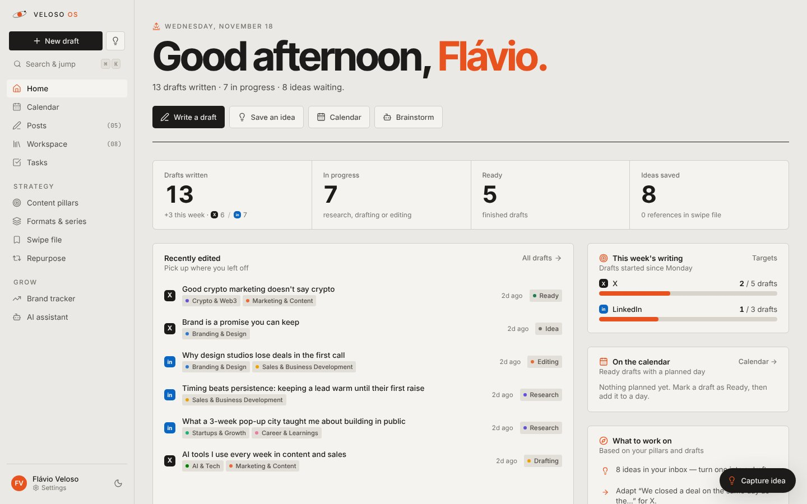
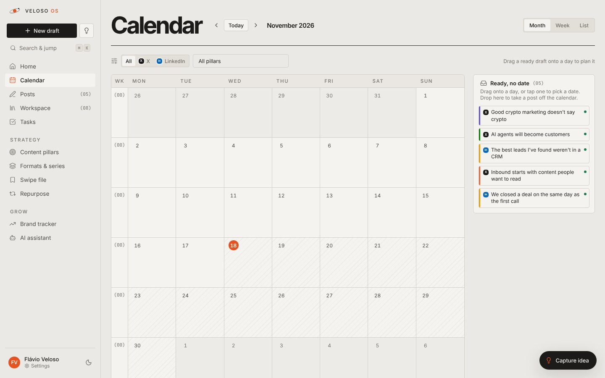
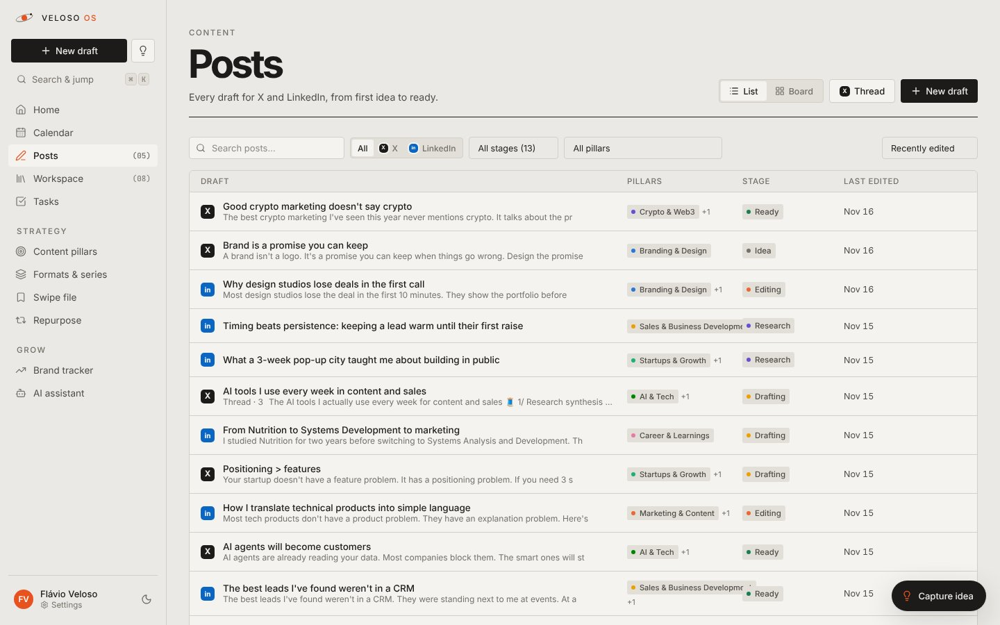
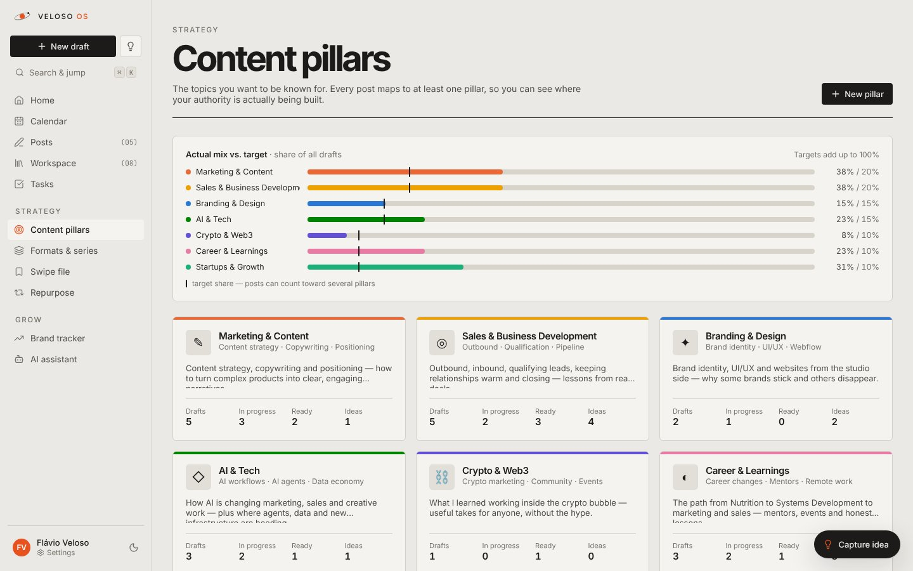
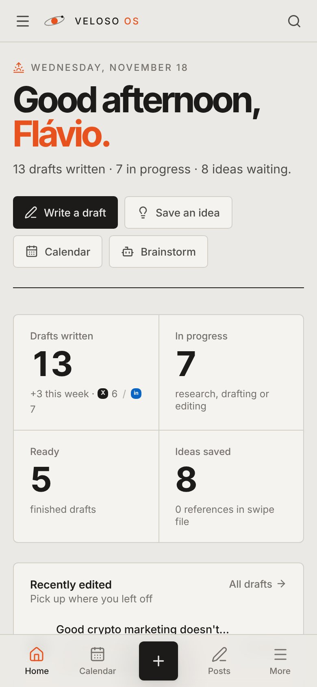

# Veloso OS — Content Planning

A personal content operating system for X and LinkedIn: plan, write, schedule and repurpose posts for the Flávio Veloso brand, all in one HTML file.

**Live:** [planning-fhcv.vercel.app](https://planning-fhcv.vercel.app)



## What's inside

| Section | What it does |
| --- | --- |
| **Home** | Greeting, weekly writing targets for X and LinkedIn, recently edited drafts, what's on the calendar and what to work on next. |
| **Calendar** | Month, week and list views. Drag a ready draft onto a day to plan it. |
| **Posts** | Every draft for X and LinkedIn as a list or a board, filtered by platform, stage and pillar, with an editor for posts and X threads. |
| **Workspace** | Ideas inbox, research and references, strategies, personal branding notes, drafts, published content, series and swipe file. |
| **Tasks** | Research, writing, visuals and reviews, with priority and due dates. |
| **Content pillars** | The topics the brand stands for, with the actual mix of drafts compared with each pillar's target share. |
| **Formats & series** | Reusable post templates and series that group recurring drafts. |
| **Swipe file** | Hooks, structures, stats and posts worth learning from, tagged by type and source. |
| **Repurpose** | Turn one idea into an X post, X thread, LinkedIn post or series episode; every version links back to its original. |
| **Brand tracker** | Audience snapshots, writing consistency and goals. |
| **AI assistant** | Content ideas, hooks, rewrites, variations and LinkedIn ↔ X adaptation, briefed on the voice profile and pillars. Works when the page is opened inside claude.ai. |
| **Settings** | Profile, weekly targets, voice profile, pillars, light / dark theme, and JSON backup and restore. |

<table>
  <tr>
    <td></td>
    <td></td>
  </tr>
  <tr>
    <td></td>
    <td align="center"></td>
  </tr>
</table>

### Where data lives

Opened as a normal web page, everything is saved in the browser (`localStorage`) on that device. Opened inside claude.ai, it is saved to private Claude storage on the account and the AI assistant is enabled. Use **Settings → Data & backup** to export or restore a JSON backup.

## Built with

- **React 19**, bundled into a single self-contained `index.html`
- **Tailwind CSS 4**, compiled and inlined
- **Tiptap** (ProseMirror) for the post editor
- **Recharts** for the Brand tracker charts and **Lucide** icons
- **Inter**, **Inter Tight** and **JetBrains Mono** from Google Fonts
- Deployed on **Vercel**

## Project structure

```
.
├── index.html    # the whole app: markup, styles and scripts
├── favicon.svg   # app logo
├── docs/         # screenshots used in this README
└── README.md
```

## Run locally

No install needed. Open `index.html` in a browser, or serve the folder:

```bash
npx serve .
```

## Contact

- [LinkedIn](https://www.linkedin.com/in/fl%C3%A1vio-veloso-a29b02254/)
- [X @flaviovlso](https://x.com/flaviovlso)
- [github.com/flaviohcveloso](https://github.com/flaviohcveloso)

---

© 2026 Flávio Veloso. All rights reserved.
